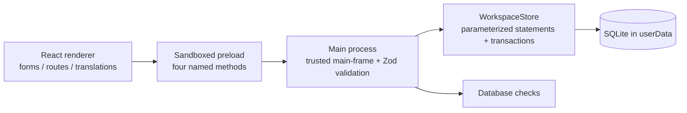

# Phase 0 architecture

This document records the original Phase 0/1 design and delivery. The current 0.4.0 implementation extends it with [registration](PHASE-2.md), [life events](PHASE-3.md) and [financial management](PHASE-4.md), schema version 4 and 45 named IPC methods. The sections below retain the original foundation context; later delivery reports describe the implemented extensions.

Inspected 25 October 2026. The workspace was empty: no source code, package manifest, Git repository or inherited project instructions. Node 24.18.0 and npm 11.16.0 were available; Git and a Visual Studio C++ build environment were not on PATH. No existing work was overwritten. No live personal information was supplied or imported.

## Exact Phase 1 change

Create a single-mosque offline Electron installation with four foundation routes: dashboard, read-only wards, editable workspace settings, and configuration activity. Add one schema migration, typed IPC contracts, defensive startup, developer tooling, executable tests, an unsigned Windows packaging target and documentation. Future navigation communicates availability without fake actions or business data. No cloud deployment or external-account integration is needed.

## Boundaries

The renderer has no Node, filesystem, raw SQL or arbitrary IPC access. It renders structured results; SQL exceptions and filesystem paths are not returned. A failed save does not trigger a success message. Storage writes validate twice (IPC and store) so a future CLI/service caller cannot bypass invariants. Settings updates use a revision predicate to avoid silent lost updates. Their activity append is in the same transaction.

The main process owns lifecycle, userData, single-instance locking, protocol and storage. The preload only maps named methods. The UI uses React Router, React Hook Form + Zod, TanStack Table and Lucide. Tailwind uses `@tailwindcss/vite`; no legacy initialization commands. CSS tokens describe shared light/dark surfaces and controls. Fonts ship with the app, not a network CDN.

SQLite 13 uses Node-API prebuilt binaries. The traditional `electron-builder install-app-deps` tried to compile unnecessarily on this machine. `npmRebuild: false` and `scripts/verify-native.mjs` use and verify the supplied binary; tests also exercise it under Electron. The separate packaged native test exists but is blocked by this machine's Device Guard policy, so packaged execution is not verified. This follows the [SQLite 13 release notes](https://github.com/WiseLibs/better-sqlite3/releases/tag/v13.0.0). Change that decision if a future native dependency requires a V8-ABI-specific build. TanStack Table 8.21.3 and Hook Form resolver 5.2.2 are deliberately pinned: table 9 has a different API; resolver 6 introduced an optional-peer conflict in this environment. Other versions are pinned in the lockfile.

Packaging reuses the installed Electron distribution and writes final artifacts under `release/windows-preview`. Earlier attempts encountered Windows file locks; their incomplete directories are retained outside that final output. NSIS failed launching the unsigned helper (`spawn UNKNOWN`). A separate packaged launch reported Device Guard block/exit 4551. The helper was renamed `release/phase1/FAILED-uninstaller-generator.exe` so it cannot be mistaken for a completed installer. Production signing and approved-machine execution remain unresolved. This execution shell also omitted System32 from PATH; the final packaging command added the standard Windows System32 and WindowsPowerShell directories for that process only.

## Implemented schema

| Table | Purpose and constraints |
| --- | --- |
| `schema_migrations` | Ordered version, name, SHA-256 checksum, UTC application time. Newer or changed history stops startup. |
| `mosque_settings` | Single row id=1; bounded text, locale/theme CHECK constraints, revision counter. |
| `wards` | Stable IDs, unique code, FK to the single mosque, active flag, sort order, bilingual name. |
| `audit_events` | Append-only configuration events with UTC timestamp. No profile contents or secrets copied into logs. |

The migration batch runs in an exclusive transaction. Failed SQL and version inserts roll back together. Applied SQL must never be edited: append migration 2 for the next change. WAL, FULL synchronous mode, foreign keys, bounded busy timeout and indexes are enabled. A native online backup API is available in the dependency, but no backup feature is exposed or claimed in this milestone.

An append-only SQLite trigger is an application safeguard, not tamper evidence against someone who controls the OS/database file. Event actor `local-preview` is explicitly unauthenticated; staff-attributed audit belongs with authentication.

## Security baseline

- `contextIsolation: true`, `nodeIntegration: false`, `sandbox: true`, web security on, webviews off.
- `app://mosque/index.html` serves only the entry document and confined bundled assets, following Electron's [security guidance](https://www.electronjs.org/docs/latest/tutorial/security/) and [protocol API](https://www.electronjs.org/docs/latest/api/protocol).
- Main-window identity, main-frame identity and exact trusted document are checked at IPC ingress. All four requests have strict Zod schemas. Arbitrary SQL, files, shell commands, downloads and external navigation are not part of the API.
- Permissions are denied. External renderer requests and new windows are blocked. Packaged `connect-src 'none'`; scripts/styles/fonts are local. No telemetry or automatic updater.
- Development alone allows the exact Vite loopback origin plus HMR WebSocket and inline development preambles/styles. Packaged builds ignore development environment overrides and use the strict CSP.
- Development and test profiles are separate from the packaged application. Production database redirection/reset is not exposed. The preview contains no secrets, cloud provider SDKs or authentication shortcuts.

Local auth, ward-scoped RBAC, secure password hashing, inactivity lock, export authorization, encryption, secure backup key handling and independent security review remain release gates. Windows account/file protections currently bound local access. This foundation is intentionally not approved for sensitive records.

## Later schema direction (not implemented)

Use stable opaque household/member/event IDs independent of configurable household numbers. Model household assignments and member transfers as effective-dated history. Guardian must reference a living member assigned to the household, validated transactionally; avoid a circular insertion problem by creating household then member then guardian inside a transaction. DOB is nullable and age is calculated. Deceased status changes living statistics without deleting history.

Marriage/divorce/death events preserve original relationships and require deliberate administrative transitions. Sensitive divorce details have separate permissions. Payments use integer paise, immutable posting/reversal entries, receipt sequence allocation within the transaction, idempotency keys, allocation records for partial payments and reconcilable adjustments. Rates and waivers are effective-dated. Do not derive legal/religious validity from the software.

Attachments will live in a controlled userData subtree with opaque IDs, validated types/sizes, content digests and a manifest. They must join consistent encrypted backups and restore verification. Import will stage parsed rows, map fields, preview duplicates/errors and apply a whole authorized batch transactionally. No arbitrary renderer-supplied file paths.

Optional cloud messaging/payment services will be separate adapters using authenticated requests, official WhatsApp templates/consent, outbox idempotency, retry state and signed webhook verification. Provider credentials must not ship in the installer. No unattended cloud automation claim for an offline computer. Separate service/repository interfaces allow a later hosted implementation, without premature tenancy or SQLite shared-folder concurrency.

## Runtime requirements

Target Windows 10/11 x64. Design minimum desktop window: 980×700; recommended 1440×1000 or greater. Compact CSS is tested separately. 4 GB RAM and local disk are planning assumptions, not measured performance guarantees. Dataset capacity of approximately 500 families is a later load-test target, not a Phase 1 benchmark.

## Phase 4 finance boundary

Migration 4 adds integer-paise financial tables and immutable posting/audit guards without changing migrations 1–3. FinanceStore owns transactional commands, session roles and idempotency; finance-queries and finance-reports calculate balances and reports. Twenty-five explicit finance IPC methods are added to the sandboxed preload. Every handler validates sender, main frame, origin and input and denies ordinary/packaged workspaces before accessing financial records. The finance-demo profile is separate from registration and life-event demo data. Native PDF/print, PNG selection, Excel/CSV output and SQLite backup remain in the main process; the renderer cannot choose arbitrary filesystem paths or send SQL. See [Phase 4](PHASE-4.md) for file mapping and accounting semantics.
