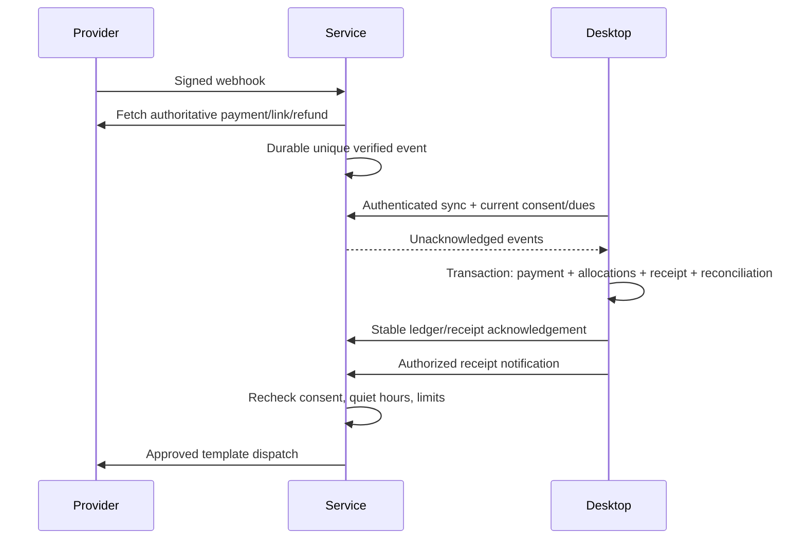

# Phase 5 — notifications and payment integration

Version **0.5.0**, Windows source application. Phase 5 is implemented as a separate **fictional integration simulation**, plus a separately built integration-service foundation. No real messages were sent, no provider accounts were connected, no live money was processed, and no service was publicly deployed.

## Open the application

Double-click **Open-Mosque-Integrations.cmd** in the project folder. With dependencies already installed, this opens the built application. Alternatively:

```powershell
cd C:\Users\Lenovo\Documents\mosqedatacollecting
npm.cmd run build
npm.cmd run demo:integrations
```

Use `npm.cmd ci` first on a new development machine with Node 24.18+ in the 24.x line. This is a source launcher, not an installer. The old Phase 1 executable does not include Phase 5. The earlier Device Guard/NSIS failures were not bypassed or retried; no current verified installer is delivered.

The separate profile is `%APPDATA%\Mosque Suite Development\integrations-demo\`. It starts with fictional wards and no households. Registration, life events and Phase 4 finance work in this profile. Other profiles are not copied or replaced. Ordinary/packaged workspaces reject integration commands. Selectable demo roles exercise authorization checks but **do not authenticate staff**.

## Implemented workflows

| Area | Behavior |
| --- | --- |
| Notifications | Family/message search, ward/date/status filters, previews, counts, approval queue, bulk approval/cancellation, delivery status and attempt history |
| Consent | E.164 guardian number, English/Malayalam preference, separate receipt/reminder choices, evidence, explicit confirmation, opt-out history; guardian, registered phone or guardian eligibility changes invalidate prior consent |
| Templates | English/Malayalam defaults, create/edit, allowlisted variables, local demo review; changing a template cancels its pending jobs |
| Offline operation | Prepare and approve jobs in local SQLite, cancel before sending, persist across restart; connect and synchronize explicitly to process |
| Reminders | Individual, ward or all eligible families; no consent and paid accounts excluded; one family/template/month batch, consent recheck at dispatch, configurable minimum frequency and quiet hours |
| Schedules | Three days before, on, seven days after due date, or monthly day 1–28; enable/edit, preview rule and prepare today's batch; every batch requires approval |
| Payments | Backend-calculated amounts from synchronized category dues, unique command/link references, expiry/cancellation, verified captures, pending reconciliation, conflict review and excess credit |
| Receipts | Existing Phase 4 official receipt generated atomically with the ledger posting; English/Malayalam notifications; explicit approval by default or configured automatic authorization; manual receipt resend |
| Private delivery | Fresh ten-minute receipt capability at dispatch; only its hash is stored; minimal bilingual HTML receipt summary, no family/life-event details; full issued receipt remains in Phase 4 |
| Refunds | Administrator request, bounded amount, stable request ID, provider verification, a separate immutable ledger correction; uncertain requests held rather than duplicated |
| Settlements | Separate settlement observation, never inferred from capture; mock settlement operation and status are implemented; real bank settlement reconciliation remains a provider deployment task |
| Optional channels | Shared provider interface and disabled adapter; email/SMS are not enabled |
| Settings | Mock connection test/offline toggle, next-send simulation, sender/WABA display labels, template review, quiet hours, frequency/rate limits, automatic receipt preference, synchronization and audit |

Messages omit guardian names, house addresses, identity numbers and private event information. Payment links use `payments.invalid` in the demo and cannot collect money. Sender/WABA fields in the desktop are labels, not provider configuration. Quiet-hour start equal to end disables quiet hours; the initial default is 21:00–08:00 India time. The initial reminder interval is 168 hours and rate limit five attempts per minute.

Schedules operate on generated, currently billable dues. Before-date reminders spanning an unstarted accounting period wait until that period becomes billable; future-period advance collection is not introduced by Phase 5. Manual payments update the synchronized balance and suppress obsolete reminders. Automatic receipt delivery currently follows reconciled online captures; manual cash receipts remain in the existing finance workflow.

## Reconciliation authority

The **desktop ledger is the sole finalized accounting authority**. The service stores verified provider facts and acknowledgements, not a second financial ledger.



Raw webhook bodies use HMAC-SHA256 verification and constant-time comparisons. Event identifiers and provider payment/refund identifiers have unique constraints. The service verifies INR, exact link amount, payment/link association and captured/refunded authoritative state. It does not trust redirects or success screens.

Desktop posting uses a stable command UUID derived from the verified event. Ledger posting, allocation, receipt and reconciliation status commit in one SQLite transaction. A lost response or acknowledgement does not post twice. Verified events remain durable while the desktop is offline. Acknowledged events and immutable local reconciliation history retain their stable identifiers.

If dues changed after link creation, the event is held for review. An administrator may apply the amount to remaining matched dues and preserve excess as family credit, with a reason. Refunds retain the original payment and receipt; they add a correction. Refund-first normalized events persist their authoritative capture first. For a real unmatched refund envelope the HTTP endpoint rejects it for provider retry until the capture/link association exists; it never guesses a family.

Duplicate webhook delivery is acknowledged without new posting. A repeated simulated webhook intentionally reports rejection so the desktop can demonstrate it. A genuine captured payment remains reconcilable even if its local link expired while the webhook was delayed.

## Queue and scheduling boundaries

Local preparation and approval work without internet. Synchronization first uploads consent changes/cancellations, then reconciles money, then dispatches eligible approved messages. Opt-outs arriving via signed Meta text webhooks (`STOP`, `UNSUBSCRIBE`, `നിർത്തുക`) immediately suppress service jobs, are deduplicated by incoming message ID and synchronize back to desktop consent history. Fresh explicit consent is required to resume.

The queue records `sending` before the provider call. Rate limits back off from one minute, doubling to a one-hour ceiling, with at most five attempts. An ambiguous timeout, malformed success response, server failure or interrupted send becomes `uncertain`; it is **not** automatically retried. Explicit receipt resend is available for sent/delivered/definitively failed messages, not uncertain sends. Provider IDs allow delivery webhooks to update status without repeating the send.

The embedded service runs with the desktop and uses the **Synchronize & process** action. It does not run after the app closes. The separately started service has a 30-second worker that prepares scheduled batches and dispatches already approved jobs independently. Scheduled batches still await staff approval. It uses only the synchronized minimal records, pauses sending/scheduling if the snapshot is older than 24 hours, and cannot know about an offline local change until it is synchronized. Desktop and service use the same deterministic monthly job ID to prevent competing schedule batches.

## Service setup for developers

`npm.cmd run build:service` creates `dist-service/main.cjs`. This artifact is **excluded from Electron packaging**. The installed desktop connects only to its authenticated loopback mock service. A production desktop pairing/configuration interface is intentionally not delivered before staff authentication and secure credential provisioning.

To run the separate mock service, supply these **server environment variables**, then run `npm.cmd run service:mock`:

| Variable | Required value |
| --- | --- |
| `MOSQUE_PROVIDER_MODE` | `mock` (default) or `razorpay-test`; there is no live mode |
| `MOSQUE_WORKSPACE_ID` | UUID for this single workspace |
| `MOSQUE_SERVICE_DATABASE` | Absolute dedicated SQLite path, outside any served directory |
| `MOSQUE_DEVICE_TOKEN` | Unique random credential, at least 32 characters |
| `MOSQUE_ADMIN_TOKEN` | Different unique random credential, at least 32 characters |
| `MOSQUE_WEBHOOK_SECRET` | Unique webhook secret, at least 32 characters |
| `MOSQUE_SERVICE_PORT` | Optional loopback port, default 8787 |

Generate random values with a secure password manager or `crypto.randomBytes(32)`. Do not paste tokens into React, source-controlled files, SQLite configuration, screenshots or logs. Use a secret manager/protected service environment. The embedded mock generates fresh process-only credentials on each launch. Logs omit credential values and payloads.

The server binds to `127.0.0.1`. Mock mode permits loopback HTTP. Razorpay test mode requires `MOSQUE_TLS_KEY_FILE`, `MOSQUE_TLS_CERT_FILE` and `MOSQUE_PUBLIC_ORIGIN` (an HTTPS origin), plus backend-only `RAZORPAY_KEY_ID` beginning `rzp_test_` and `RAZORPAY_KEY_SECRET`. A reviewed TLS reverse proxy, credential provisioning and public webhook deployment remain separate authorized work. Do not disable certificate validation.

HTTP JSON endpoints use a Bearer device/admin credential: `/sync`, `/changes`, `/dispatch`, `/links/create`, `/links/cancel`, `/ack`, `/receipt-token`; `/refund` and `/mock/*` require the admin credential. `/health` requires authentication. Requests reject browser `Origin` headers, unknown fields, oversized bodies (2 MiB) and excess traffic (180 requests/minute per service). Production reverse proxies also need per-source controls, monitoring and access-log redaction. Do not log receipt query tokens. No CORS bridge or arbitrary renderer HTTP/SQL channel is exposed.

Public provider routes are `/webhooks/payment` and `/webhooks/meta`. Razorpay supports `payment_link.paid` and `refund.processed` envelopes, `X-Razorpay-Signature`, and `X-Razorpay-Event-Id`. Meta verifies its **separate app secret**, WABA ID and sender phone-number ID. The verification challenge requires `META_VERIFY_TOKEN`. Set `META_APP_SECRET`, `META_WABA_ID` and `META_SENDER_ID` only on the service.

WhatsApp sending is disabled in the standalone non-mock service unless an operator deliberately sets `MOSQUE_ENABLE_META_TEST=AUTHORIZED_TEST_RECIPIENTS_ONLY`, `META_ACCESS_TOKEN`, `META_GRAPH_VERSION`, `META_ALLOWED_RECIPIENTS` (comma-separated E.164 allowlist), and `META_TEMPLATE_MANIFEST` (protected JSON file path). **Do this only after explicit authorization to send to those real test recipients.** No such configuration was enabled during implementation.

The server-owned manifest maps each local template UUID to:

```json
{
  "10000000-0000-4000-8000-000000000001": {
    "name": "provider_approved_reminder",
    "locale": "en",
    "language": "en_US",
    "body": "Assalamu Alaikum. {{mosque}} contribution for {{period}}: INR {{amount}} outstanding. {{payment_link}}"
  }
}
```

The operator must supply a provider-approved template matching the static text and parameter order. The adapter validates the rendered message against this server-owned pattern, uses the configured provider language/name and restricts recipients to the explicit test allowlist. A desktop “reviewed for simulation” checkbox does not constitute Meta approval. The graph version is deliberately supplied by the operator and must be checked against the account's supported API version.

Razorpay test links disable provider SMS/email/reminders and partial payments. Ambiguous create/refund calls stay held and require provider-side investigation; they are not retried as new money operations. Real settlement fees/bank totals, operational reconciliation tooling and provider acceptance testing remain deployment requirements.

Provider references: [Razorpay signature and duplicate verification](https://razorpay.com/docs/webhooks/validate-test/), [standard payment links](https://razorpay.com/docs/api/payments/payment-links/create-standard/), [payment-link fields](https://razorpay.com/docs/api/payments/payment-links/cancel-standard/), and [Meta's template API example](https://whatsapp.github.io/WhatsApp-Nodejs-SDK/api-reference/messages/template/). Meta's SDK example is archived; validate current account/template behavior against the configured Graph API before authorizing a real test. No unofficial WhatsApp Web automation is used.

## Storage and changed files

Migration 5 only adds integration tables; migration SQL/checksums 1–4 are unchanged. Foreign keys, strict tables, indexes, immutable histories and unique deduplication/reconciliation constraints protect the local records. The service maintains its own SQLite file and schema version 1; it refuses newer versions.

| Files | Purpose |
| --- | --- |
| `shared/integrations.ts`, `shared/integration-labels.ts` | Contracts, strict validation, statuses and bilingual strings |
| `electron/database/integrations-migration.ts`, `integrations-store.ts` | Migration 5, consent/queue, authenticated sync and atomic reconciliation |
| `electron/integration-client.ts`, `integrations-ipc.ts`, `main.ts`, `preload.ts` | Isolated service/profile and 16 named integration methods (61 total desktop methods) |
| `service/protocol.ts`, `engine.ts`, `server.ts`, `webhooks.ts` | Durable queue, verified event inbox, HTTP authorization/TLS, provider envelopes, private receipts and hosted scheduling |
| `service/providers.ts`, `mock-providers.ts`, `main.ts` | Official provider adapters, mocked providers and separate service entry point |
| `src/pages/Integrations.tsx`, `src/components/integrations/IntegrationShared.tsx`, `src/integrations.css` | Seven functional routes and shared UI |
| `src/App.tsx`, `Layout.tsx`, `Settings.tsx`, `FamilyProfile.tsx` | Navigation and family/settings entry points |
| `tests/unit/integrations*.test.ts`, `integration-service.test.ts`, `tests/e2e/integrations.spec.ts` | Queue, security, payments, migration and actual Electron workflow tests |
| `scripts/build-service.mjs`, `service.mjs`, `start.mjs`, `Open-Mosque-Integrations.cmd` | Build and launch support |

Phase 4 SQLite backups include the desktop integration tables but **do not include the separate service database**. Preserve both databases and their relationship to the workspace UUID. For a consistent offline copy, stop the desktop/service cleanly, preserve each database and any remaining WAL/SHM companions together, and keep copies access-controlled. Never copy a running SQLite file alone or restore one side of the reconciliation pair casually. Automated encrypted paired backup/restore and retention policies remain production work. Provider secrets belong in the secret manager, not database exports.

## Manual verification

1. Create fictional families in the integration demo. In Finance, assign a ₹150 monthly plan and generate two months of dues.
2. In Messaging consent, select one family, enter a fictional E.164 number and evidence, choose reminder/receipt consent and confirm. Leave a second family without consent.
3. Prepare reminders, preview the approved English or Malayalam template, inspect exclusions and save for approval. Approve with a reason. It remains queued while offline; restart to confirm persistence.
4. In Integrations, connect the mock service. Synchronize and process. The message becomes accepted by the mock. Simulate delivery from Notifications. To test retry, select the next-send rate-limit outcome before processing a new approved batch; wait until its retry time. An uncertain outcome remains held.
5. Create a simulated payment link for the consenting family. Test invalid signature; no ledger entry appears. Simulate verified payment and synchronize. The correct dues settle once and one official Phase 4 receipt appears. Test replay and synchronize again; counts do not increase.
6. Approve the queued receipt notification, or enable automatic receipt authorization beforehand. Synchronize. Review the original bilingual receipt in Finance. Prepare a manual receipt resend if needed.
7. Test consent withdrawal before a pending send, schedule enable/edit and today's batch preparation, changed-dues conflict review, a partial simulated refund and mock settlement observation. Synchronize after provider simulations to see finalized status.
8. Switch to Malayalam and dark mode; verify keyboard forms, preview and offline family access. Use only fictional records.

Verified on **29 October 2026**: `npm.cmd run check` passed **87 unit/component/service tests** and **25 real Electron tests**; **one packaged executable test was skipped**. TypeScript, Vite renderer, Electron main/preload and the separate service build all passed. Earlier registration/life-event/finance workflows, PDF/Excel/CSV exports and the 500-family finance case also passed. Phase 5 pages passed automated WCAG 2 A/AA and 2.1 AA checks; English and Malayalam/dark screenshots were visually reviewed. The standalone mock CLI also passed an authenticated health check with no credential leakage in its startup log. After tightening startup validation, TypeScript, both backend builds and the seven affected service tests passed again. Tests inject provider responses and do not call Meta/Razorpay or deploy services. Screenshots are under ignored `tmp/phase5-review/`.

## Requirements before real operation

Authenticated staff/ward permissions, secure desktop-to-hosted-service pairing, provider account approval/credentials and approved templates, explicit real-recipient authorization, reviewed TLS hosting, provider test acceptance, actual settlement reconciliation, monitoring, retention/encrypted recovery and signed distribution remain required. There is no live-mode switch. This phase does not begin any unrelated module.
